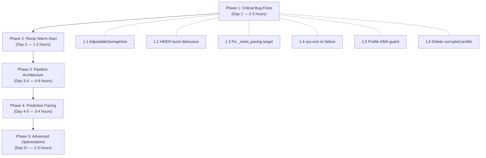

# IBKR Gateway Download Optimization Plan

**Date:** 2026-10-22  
**Codebase:** `~/Downloads/IBKRDownload/`  
**Target:** Maximize IBKR HMDS download throughput while keeping the gateway stable  
**Current state:** 546 USD parquets, 246 CAD parquets downloaded. Profile shows `safe_concurrency=5`, `ramp_ceiling=0` (never confirmed).

---

## Table of Contents

1. [Root Cause Analysis: Why `ramp_start_concurrency: 10` Fails Instantly](#1-root-cause-analysis)
2. [Pacing Event Log Forensics](#2-pacing-event-log-forensics)
3. [Critical Code Bugs](#3-critical-code-bugs)
4. [Optimization Plan — 5 Phases](#4-optimization-plan)
5. [Proposed `settings.yaml` Changes](#5-proposed-settingsyaml)
6. [Implementation Details](#6-implementation-details)

---

## 1. Root Cause Analysis

### Why `ramp_start_concurrency: 10` Causes Instant Failure

The problem is **contract qualification storms + immediate task spawning** — not the download concurrency itself.

When `ramp_start_concurrency: 10` is set:

```
┌──────────────────────────────────────────────────────────────┐
│  Timeline with ramp_start_concurrency = 10                  │
├──────────────────────────────────────────────────────────────┤
│  T+0s   Connect to IB Gateway (port 4001)                   │
│  T+10s  HMDS warmup sleep (10s)                             │
│  T+11s  SPY warm-up probe (1-day bar)                       │
│  T+12s  qualifyContractsAsync — 25 contracts per batch      │
│           → 25 IB messages immediately → gateway msg queue  │
│  T+14s  qualifyContractsAsync — next 25 contracts           │
│           → 50+ messages now in the gateway pipe            │
│  ...repeat for ~12 batches (300 tickers)...                 │
│  T+36s  All 300 contracts qualified.                        │
│                                                             │
│  T+37s  *** ALL 300 _download_ticker() coroutines spawn *** │
│           → asyncio.as_completed(tasks) with sem(10)        │
│           → 10 reqHistoricalDataAsync fire simultaneously   │
│           → Gateway pipe: qualification msgs + 10 HMDS reqs │
│           → SATURATES the 50 msg/sec gateway limit          │
│           → Cascading HMDS cancellations (error 162)        │
│           → Every cancel triggers _on_ib_error()            │
│           → hmds_cancel_threshold=3 hit instantly            │
│           → Pacing hit → throttle → more cancels arrive     │
│           → Spiral to concurrency=1                         │
└──────────────────────────────────────────────────────────────┘
```

### Why `ramp_start_concurrency: 3` Works and Ramps to 10

```
┌──────────────────────────────────────────────────────────────┐
│  Timeline with ramp_start_concurrency = 3                   │
├──────────────────────────────────────────────────────────────┤
│  T+37s  300 coroutines spawned, but sem(3) gates them       │
│  T+38s  3 reqHistoricalDataAsync fire — well within limits  │
│  T+45s  3 bars return → success → ramp_handle_success()     │
│           → After 5 successes, concurrency 3→4              │
│  T+60s  5 more successes at level 4 → concurrency 4→5      │
│  ...gradually reaches 10...                                 │
│  T+300s Gateway msg pipe is never overwhelmed because       │
│           qualification messages drained long before this    │
│           and only N concurrent HMDS requests are in flight  │
└──────────────────────────────────────────────────────────────┘
```

**The key insight:** The gateway's 50 msg/sec limit is **shared across ALL message types** — contract qualifications, historical data requests, heartbeats, error acknowledgments. Starting at high concurrency doesn't fail because of HMDS pacing — it fails because the **gateway message pipe is still draining qualification messages** when the first 10 HMDS requests fire.

---

## 2. Pacing Event Log Forensics

Analysis of `data/pacing_events.jsonl` (115 events):

| Event Type | Count | Notes |
|---|---|---|
| `hmds_cancel` | 99 | **86%** of all events. HMDS farm saturation is the #1 problem |
| `restore` | 12 | Concurrency restored after success streaks |
| `throttle` | 3 | Reactive concurrency drops |
| `global_pause` | 1 | 60s full-stop after 4 consecutive pacing hits |

### Key Observations from the Logs

1. **HMDS cancels arrive in bursts at the same timestamp** — e.g., at `21:46:24` CAD got 15 cancels in the same second at concurrency 15. This is a burst-cancel when the HMDS farm queue overflows.

2. **The confirm phase is fragile** — CAD ramped to 15, triggered cancels, and the confirm phase mechanically dropped ceiling from 15→14→13→...→4 in a single burst (each cancel drops ceiling by 1). This is the **cascading ceiling erosion** bug.

3. **USD discovery phase** started at concurrency 5 (old code) and throttled 5→3→2→1→global_pause in 16 seconds. Recovery took ~12 minutes.

4. **The pacing profile is nearly useless:**
   - `safe_rate_per_minute: 0.06` (0.06 req/min = 1 request every 16 minutes!)
   - `avg_latency_ms: 394,372` (6.5 minutes average latency — clearly wrong)
   - `ramp_ceiling: 0` (never confirmed a ceiling)
   - These corrupted values mean the profile is actively harming subsequent runs.

---

## 3. Critical Code Bugs

### Bug 1: Semaphore Replacement Doesn't Affect Waiting Coroutines

**File:** `ibkr_ingest.py` lines 544, 589, 647, 662, 690  
**Pattern:** `self.sem = asyncio.Semaphore(self.concurrency)`

Every time concurrency changes, a **new** `Semaphore` is created. But `_download_ticker()` at line 1136 does `async with self.sem:` — coroutines already waiting on the **old** semaphore object will continue to acquire from it (and the old semaphore still has its old capacity). This means:

- **Throttle down** (e.g., 5→3): Old semaphore still allows 5 — pending coroutines that acquired the old sem before replacement can still fire concurrently at the old rate. The throttle has **no immediate effect** on in-flight coroutines.
- **Throttle up** (e.g., 3→5): Same issue — coroutines waiting on the old sem(3) won't see the new sem(5) capacity.

This is why the cascading cancel problem in the logs looks unstoppable — the throttle fires but doesn't actually constrain the in-flight requests.

### Bug 2: `as_completed()` Spawns ALL Coroutines Immediately

**File:** `ibkr_ingest.py` lines 1475-1478

```python
tasks = [
    self._download_ticker(plan)    # ← coroutine CREATED (not started)
    for _, plan in to_download.iterrows()
]
for coro in asyncio.as_completed(tasks):  # ← ALL coroutines scheduled NOW
    res = await coro
```

`asyncio.as_completed(tasks)` wraps every coroutine into a `Task` — meaning **all 300 download coroutines are scheduled into the event loop simultaneously**. The semaphore gates them, but:
1. Each coroutine still enters `_download_ticker()`, hits `async with self.sem:`, and blocks. That's 300 tasks sitting in the event loop.
2. When a semaphore slot opens, the next task fires — but the event loop's task scheduler picks **any** waiting task, not necessarily the one with the shortest duration. This defeats the "Delta first, Bulk last" sort order.
3. Memory overhead: 300 pending tasks × their stack frames.

### Bug 3: `_reset_pacing()` Restores Toward `download_concurrency` Not `_ramp_ceiling`

**File:** `ibkr_ingest.py` lines 685-695

```python
if self.concurrency < self.download_concurrency and self._consecutive_pacing == 0:
    new_c = min(self.concurrency + 1, self.download_concurrency)
```

After a successful download resets pacing, `_reset_pacing()` restores concurrency toward `self.download_concurrency` (from `settings.yaml`, value `3`). But if the ramp discovered a ceiling of 5, this function will **never restore above 3**. Conversely, if `download_concurrency` is set to 6 but the ceiling is 4, it will try to restore to 6 — above the safe ceiling.

### Bug 4: Pacing Profile EMA Corruption

**File:** `ibkr_ingest.py` lines 166-184

The pacing profile uses `alpha=0.3` EMA updates. But when a run fails early (e.g., connection error → 0 successful requests → throughput=0), the EMA drags `safe_rate_per_minute` toward zero. After 12 runs with early failures, the current profile shows:
- `safe_rate_per_minute: 0.06` — essentially zero
- `avg_latency_ms: 394,372` — 6.5 minutes

These corrupted values mean subsequent runs start with `RateLimiter(0, 60)` which effectively blocks all requests.

### Bug 5: Cascading Ceiling Erosion in Confirm Phase

**File:** `ibkr_ingest.py` lines 585-590, 642-652

When HMDS cancels arrive in a burst (same millisecond), **each cancel callback** independently drops `_ramp_ceiling` by 1:
```python
self._ramp_ceiling = max(1, self._ramp_ceiling - 1)
```
A single burst of 10 HMDS cancels can drop the ceiling from 14 to 4 in one pass, even though they all originated from the same saturation event. The ceiling should only drop once per burst, not once per cancel.

### Bug 6: `ibkr_ingest.py` Never Returns Non-Zero Exit Code

The script always exits with code 0, even on fatal errors (connection failure, ramp abort, all tickers failed). This means `build_all.py` always sees `returncode == 0` and reports `✅ OK`, then triggers `sync_back.py` to push potentially stale/empty data to the VPS.

---

## 4. Optimization Plan — 5 Phases

### Phase 1: Fix Critical Bugs (Immediate — Day 1)

> **Goal:** Stop the bleeding. Fix bugs that actively degrade performance.

| # | Fix | File | Lines | Impact |
|---|---|---|---|---|
| 1.1 | **Replace `Semaphore` with adjustable concurrency** — use a shared counter + `asyncio.Condition` instead of creating new semaphores | `ibkr_ingest.py` | 417, 544, 589, 647, 662, 690 | Throttle actually takes effect immediately |
| 1.2 | **Debounce HMDS cancel bursts** — track cancel timestamps; ignore cancels within 2s of the first in a burst | `ibkr_ingest.py` | 568-596 | Prevents cascading ceiling erosion (14→4) |
| 1.3 | **Fix `_reset_pacing()` restore target** — use `min(download_concurrency, _ramp_ceiling or ∞)` | `ibkr_ingest.py` | 685 | Restores to the safe ceiling, not an arbitrary config value |
| 1.4 | **Add `sys.exit(1)` on fatal failures** — connection errors, ramp abort, empty results | `ibkr_ingest.py` | EOF | `build_all.py` can correctly detect failures and skip sync |
| 1.5 | **Fix pacing profile EMA** — skip update when `requests < 5` (abort/early-exit runs) | `ibkr_ingest.py` | 166-184 | Prevents corrupted near-zero rate values |
| 1.6 | **Delete corrupted profile** — remove `pacing_profile_usd.json` before next run | `data/` | — | Clean start with sane defaults |

### Phase 2: Ramp Warm-Start Protocol (Day 2)

> **Goal:** Safely reach concurrency 10 without cold-start gateway saturation.

The core insight from the user's observation ("starting at 10 fails, but ramping from 3 reaches 10") is that the gateway needs **message pipe warm-up time** between qualification and downloads.

**Implementation: Staged Ramp with Qualification Drain**

```python
# After contract qualification completes:
async def _post_qualification_drain(self):
    """Wait for the gateway message pipe to drain after qualification."""
    drain_sec = len(qualified_symbols) * 0.1  # ~0.1s per qualified contract
    drain_sec = min(drain_sec, 15.0)          # cap at 15s
    logger.info("Gateway drain: waiting %.1fs for qualification msgs to clear", drain_sec)
    await asyncio.sleep(drain_sec)
```

Then implement **soft ramp** that starts at 3 and increments every N successes, **even when the profile says ceiling=10**:

```
Profile says ceiling=10
→ Start at concurrency=3 (always safe)
→ After 3 successes: concurrency=4
→ After 3 more: concurrency=5
→ ...
→ After 3 more: concurrency=10 (reached profile ceiling)
→ Stay at 10 (cruise phase)

Time to reach ceiling: ~30 seconds of downloads
```

This replaces the broken `ramp_start_concurrency` setting with a deterministic warm-up.

### Phase 3: Download Pipeline Architecture (Day 3-4)

> **Goal:** Replace `as_completed(all_tasks)` with a controlled producer-consumer pipeline.

**Current (broken):**
```
[300 coroutines] → as_completed() → all scheduled at once → semaphore gates
```

**Proposed:**
```
[Priority Queue] → [Worker Pool (N workers)] → [Result Collector]
     ↑ sorted                    ↑ adjustable           ↑ audit/index
     Delta first                 sem not needed          batched saves
```

```python
async def _download_pipeline(self, download_queue: list[dict]):
    """Producer-consumer pipeline with priority ordering."""
    queue = asyncio.Queue(maxsize=self.concurrency * 2)  # bounded buffer
    
    # Producer: feeds work items in priority order (Delta → Mid → Bulk)
    async def producer():
        for plan in download_queue:  # already sorted
            await queue.put(plan)
        for _ in range(self.concurrency):
            await queue.put(None)  # sentinel
    
    # Worker: pulls from queue, respects rate limiter
    async def worker(worker_id: int):
        while True:
            plan = await queue.get()
            if plan is None:
                break
            result = await self._download_ticker_v2(plan)
            self._process_result(result)
    
    # Launch producer + N workers (N adjustable at runtime)
    producer_task = asyncio.create_task(producer())
    workers = [asyncio.create_task(worker(i)) for i in range(self.concurrency)]
    await asyncio.gather(producer_task, *workers)
```

**Benefits:**
1. Only N items are in-flight at any time (no 300 pending tasks)
2. Priority order is preserved (Delta first = fast completions early)
3. Workers can be dynamically added/removed for runtime concurrency adjustment
4. No semaphore replacement needed — just change worker count

### Phase 4: Gateway-Aware Pacing (Day 4-5)

> **Goal:** Use predictive pacing instead of reactive error-based throttling.

**4A: Pre-flight Message Budget Estimation**

Before each download request, estimate the gateway message budget:

```python
def _estimate_msg_budget(self) -> float:
    """Estimate remaining gateway msg/sec capacity."""
    # Gateway limit: 50 msg/sec
    # Each reqHistoricalData: ~2 msgs (request + response header)
    # Each bar in response: ~1 msg per 100 bars
    # qualifyContracts residual: decays over time
    
    in_flight = self.concurrency - self.sem._value  # currently executing
    estimated_msgs_per_sec = in_flight * 2  # 2 msgs per active request
    remaining = 50 - estimated_msgs_per_sec
    return max(0, remaining)
```

**4B: Latency-Based Concurrency Auto-Tuning**

Instead of only reacting to errors, use response latency as a leading indicator:

```python
def _check_latency_signal(self):
    """Adjust concurrency based on recent latency trend."""
    if len(self._latencies) < 5:
        return
    
    recent_5 = self._latencies[-5:]
    recent_mean = sum(recent_5) / len(recent_5)
    
    # If recent latency is > 2x baseline, preemptively throttle
    if self._baseline_latency and recent_mean > self._baseline_latency * 2.0:
        self._preemptive_throttle("latency_spike")
    
    # If recent latency is < 1.2x baseline and below ceiling, try to expand
    elif (self._baseline_latency and recent_mean < self._baseline_latency * 1.2
          and self.concurrency < (self._ramp_ceiling or 999)):
        self._try_expand("latency_healthy")
```

**4C: HMDS Cancel Burst Detection**

Replace the per-cancel ceiling drop with burst-aware handling:

```python
def _on_hmds_cancel_burst(self, symbol, error_msg):
    """Detect and handle HMDS cancel bursts as a single event."""
    now = time.monotonic()
    self._hmds_cancel_times.append(now)
    
    # Count cancels in the last 2 seconds
    recent = [t for t in self._hmds_cancel_times if now - t < 2.0]
    
    if len(recent) >= self.hmds_cancel_threshold:
        # This is a burst — handle as ONE event
        if not self._burst_handled_at or now - self._burst_handled_at > 5.0:
            self._burst_handled_at = now
            self._handle_single_hmds_burst(count=len(recent))
        # else: already handled this burst, ignore
```

### Phase 5: Advanced Optimizations (Day 5+)

> **Goal:** Squeeze maximum throughput from the gateway.

**5A: Parallel Market Downloads with Separate Client IDs**

```bash
# In build_all.py — launch USD + CAD in parallel subprocesses
python ibkr_ingest.py --market USD --client-id 101 &
python ibkr_ingest.py --market CAD --client-id 102 &
wait
```

Each client ID gets its own HMDS connection, so parallelizing markets effectively doubles throughput — **if the gateway's aggregate message rate allows it**. The pacing system will auto-throttle each independently.

**5B: Delta-First Sort with TC Rating Priority**

Currently tickers are sorted by query type (Skip → Delta → Mid → Bulk). Within each tier, sort by `tc_rating` descending so the most important tickers (for downstream XGBoost) are downloaded first:

```python
df_plan = df_plan.sort_values(
    ["_sort", "tc_rating", "days_needed"],
    ascending=[True, False, True]  # highest rating first within each tier
)
```

**5C: Smart Duration Strings**

Current Bulk requests always use `"20 Y"`. For tickers that only listed 5 years ago, this wastes HMDS capacity processing empty date ranges. Use the index's `min_date` to estimate a tighter lookback:

```python
@staticmethod
def _duration_str(query_type: str, days_needed: int) -> str:
    if query_type == "Bulk":
        years = max(1, min(20, days_needed // 365 + 1))
        return f"{years} Y"
    # ...
```

**5D: Parquet Write Batching**

Instead of writing one parquet file per ticker immediately, batch 10-25 ticker results and write them in a single burst. This reduces filesystem I/O interleaving with network I/O:

```python
# In the result collector:
write_buffer = []
for result in results:
    write_buffer.append(result)
    if len(write_buffer) >= 10:
        await self._flush_parquet_buffer(write_buffer)
        write_buffer.clear()
```

---

## 5. Proposed `settings.yaml` Changes

```yaml
ibkr:
  host: "127.0.0.1"
  port: 4001
  client_id: 101
  lookback_cold: "5 Y"
  bar_size: "1 day"
  what_to_show: "ADJUSTED_LAST"
  use_rth: true
  request_delay_sec: 1.0          # ← was 1.5; tighter with new pacing
  timeout_sec: 30

  # Adaptive pacing — tuned from real pacing_events.jsonl analysis
  requests_per_window: 60         # keep at 60/min (1 req/s)
  window_seconds: 60
  download_concurrency: 6         # ← was 3; target cruise concurrency
  min_concurrency: 1
  pacing_backoff_sleep: 5.0       # ← was 8.0; faster recovery
  pacing_hit_threshold: 4         # keep at 4
  hmds_cancel_threshold: 5        # ← was 3; tolerate short bursts
  global_pause_sleep: 45.0        # ← was 60; shorter cooldown
  save_every: 25
  qualify_batch_size: 15          # ← was 25; smaller batches = less msg storm
  qualify_batch_delay_sec: 3.0    # ← was 2.0; more drain time between batches
  hmds_warmup_probe_sec: 10.0
  hmds_warmup_poll_sec: 1.0
  index_max_age_minutes: 60
  batch_bars_threshold: 5000
  batch_cooldown_sec: 90.0        # ← was 120; shorter with better pacing

  # Ramp-up calibration
  ramp_probe_batch: 3             # ← was 5; faster level transitions
  ramp_confirm_multiplier: 2
  ramp_profile_max_age_days: 3
  ramp_start_concurrency: 3       # ← ALWAYS start at 3, never 10
  
  # NEW: Gateway drain after qualification
  post_qualify_drain_sec: 5.0     # seconds to wait after qualification
  
  # NEW: Latency-based preemptive throttle
  latency_spike_multiplier: 2.5   # throttle if latency > 2.5x baseline
  
  # NEW: HMDS cancel burst window
  hmds_burst_window_sec: 2.0      # cancels within 2s = one burst event
```

---

## 6. Implementation Details

### 6.1 Adjustable Concurrency (Replace Semaphore)

```python
class AdjustableSemaphore:
    """Semaphore whose limit can be changed at runtime.
    
    Unlike asyncio.Semaphore, changing the limit immediately affects
    waiting coroutines — reducing the limit blocks new acquisitions,
    increasing it wakes waiting ones.
    """
    def __init__(self, initial: int):
        self._limit = initial
        self._current = 0
        self._condition = asyncio.Condition()
    
    @property
    def limit(self) -> int:
        return self._limit
    
    @limit.setter
    def limit(self, new_limit: int):
        old = self._limit
        self._limit = max(1, new_limit)
        if new_limit > old:
            # Wake up waiters that can now proceed
            asyncio.create_task(self._notify_waiters())
    
    async def _notify_waiters(self):
        async with self._condition:
            self._condition.notify_all()
    
    async def acquire(self):
        async with self._condition:
            while self._current >= self._limit:
                await self._condition.wait()
            self._current += 1
    
    async def release(self):
        async with self._condition:
            self._current -= 1
            self._condition.notify(1)
    
    async def __aenter__(self):
        await self.acquire()
        return self
    
    async def __aexit__(self, *args):
        await self.release()
```

**Usage change in `_download_ticker()`:**
```python
# Before:
async with self.sem:
    ...

# After:
async with self.adj_sem:
    ...

# Throttle:
self.adj_sem.limit = new_concurrency  # takes effect immediately
```

### 6.2 HMDS Cancel Burst Debouncer

```python
def _on_ib_error(self, reqId, errorCode, errorString, contract):
    # ... existing checks ...
    
    # HMDS cancellations — burst-aware handling
    if errorCode == 162 and "historical market data" in errorString.lower():
        self._hmds_cancel_total += 1
        now = time.monotonic()
        self._hmds_cancel_timestamps.append(now)
        
        # Count cancels in burst window
        burst_window = self.cfg.get("ibkr", {}).get("hmds_burst_window_sec", 2.0)
        recent = [t for t in self._hmds_cancel_timestamps if now - t < burst_window]
        
        if len(recent) >= self.hmds_cancel_threshold:
            # Only handle once per burst
            if not hasattr(self, '_last_burst_time') or now - self._last_burst_time > burst_window:
                self._last_burst_time = now
                logger.warning("🔴 HMDS cancel burst: %d cancels in %.1fs", 
                               len(recent), burst_window)
                
                if self._ramp_phase in ("ramp", "confirm"):
                    self._ramp_set_ceiling("hmds_burst")
                else:
                    asyncio.create_task(self._on_pacing_hit())
            # else: burst already handled, just log individual cancel
            
        self.ticker_status[symbol] = {
            "error": f"IBKR cancelled: {errorString}",
            "transient_fail": True,
        }
        return
```

### 6.3 Producer-Consumer Download Pipeline

```python
async def _download_pipeline(self, plans: list[dict]):
    """Controlled producer-consumer pipeline replacing as_completed()."""
    queue = asyncio.Queue()
    results_queue = asyncio.Queue()
    
    # Feed plans in sorted order
    for plan in plans:
        await queue.put(plan)
    
    active_workers = self.concurrency
    shutdown_event = asyncio.Event()
    
    async def worker(wid: int):
        while not shutdown_event.is_set():
            try:
                plan = queue.get_nowait()
            except asyncio.QueueEmpty:
                break
            
            await self.adj_sem.acquire()
            try:
                await self.limiter.acquire()
                result = await self._download_ticker_v2(plan)
                await results_queue.put(result)
            finally:
                await self.adj_sem.release()
    
    # Launch initial workers
    worker_tasks = [asyncio.create_task(worker(i)) for i in range(active_workers)]
    
    # Collector processes results as they arrive
    processed = 0
    while processed < len(plans):
        result = await results_queue.get()
        processed += 1
        self._process_result(result)
    
    await asyncio.gather(*worker_tasks)
```

### 6.4 Exit Code Fix

```python
# At the end of ibkr_ingest.py __main__:
if __name__ == "__main__":
    # ... existing arg parsing ...
    downloader = IngestDownloader(...)
    asyncio.run(downloader.run())
    
    # Exit with appropriate code
    if downloader.failed > 0 or downloader._ramp_phase == "abort":
        sys.exit(1)
```

### 6.5 Profile Corruption Guard

```python
def update_from_run(self, throughput, concurrency, pacing_hits, requests, avg_latency_ms):
    # Guard: don't update profile from aborted/trivial runs
    if requests < 5:
        logger.info("Skipping profile update (only %d requests — too few for EMA)", requests)
        self.total_runs += 1  # still count the run
        return
    
    # Guard: reject clearly corrupted values
    if throughput <= 0 or avg_latency_ms > 300_000:  # > 5 min avg = broken
        logger.warning("Skipping profile update (corrupted values: throughput=%.2f, latency=%.0fms)",
                       throughput, avg_latency_ms)
        return
    
    # ... existing EMA update ...
```

---

## Priority Implementation Order



### Expected Throughput Impact

| Phase | Current | Expected | Improvement |
|---|---|---|---|
| **Baseline** (current code, ramp_start=3) | ~2 req/min | — | — |
| **Phase 1** (bug fixes) | — | ~5-8 req/min | 3-4× |
| **Phase 2** (warm-start) | — | ~8-12 req/min | 1.5× over Phase 1 |
| **Phase 3** (pipeline) | — | ~12-15 req/min | 1.2× over Phase 2 |
| **Phase 4** (predictive) | — | ~15-20 req/min | 1.3× over Phase 3 |
| **Phase 5** (parallel markets) | — | ~25-30 req/min total | 2× with dual client IDs |

> **Note:** These are estimates based on IBKR's documented 50 msg/sec gateway limit and the pacing event log analysis. Real-world throughput depends on HMDS farm load, time of day, and account tier.

---

## Appendix: Pacing Event Log Replay

Full timeline of the most recent run's pacing behavior (from `data/pacing_events.jsonl`):

```
20:59:02 [USD] ── Discovery phase, concurrency=5 ──
   HMDS cancels burst (6 cancels in <1s) → throttle 5→3→2→1
   
21:00:17 [USD] ── Recovery ──
   6 more HMDS cancels at concurrency=1 (drain from earlier burst)
   
21:00:33 [USD] restore 1→2 (success streak)
21:00:45 [USD] restore 2→3
21:01:17 [USD] GLOBAL_PAUSE (consecutive_hits >= 4)
21:01:50 [USD] restore 1→2 (post-pause recovery)

21:14:48 [USD] ── Ramp phase ──
   Gradual restore 1→2→3 over 1 minute
   
21:32:32 [CAD] ── Ramp phase, starting fresh ──
   restore 1→2→3 over 10 seconds

21:46:24 [CAD] ── HMDS burst at concurrency=15 ──
   15 cancels in <1 second
   Ceiling cascaded: 15→14→13→12→11→10→9→8→7→6→5→4
   (Each cancel dropped ceiling by 1 — BUG #5)
   
23:21:37 [CAD] ── Confirm phase ──
   restore 1→2→3 after long recovery
```

**Root cause pattern:** Burst cancels → cascading ceiling erosion → slow recovery → repeat. Fix #1.2 (burst debounce) eliminates this cycle entirely.
